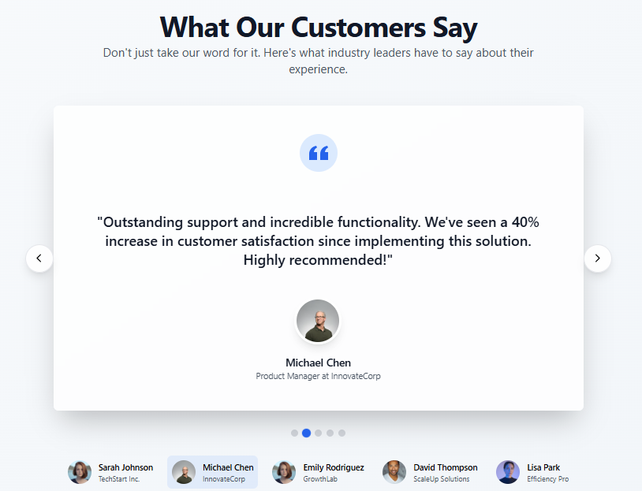

# Testimonial Carousel

A reusable React 19 and TypeScript carousel running in Next.js 15. Sample profiles, companies and reviews are fictional; they are not customer endorsements.



The existing screenshot documents the original design; navigation and playback controls have since been improved.

## Getting started

Use Node.js 22.19 or newer. Run `npm ci`, then `npm run dev` and open http://localhost:3000. Run `npm run build` and `npm start` for production. No API key or backend is required.

## Component usage

```tsx
import Testimonials, {demoTestimonials} from '@/components/testimonial-section';
<Testimonials testimonials={demoTestimonials} intervalMs={5000} />
```

Each record contains a unique `id`, `name`, `role`, `company`, `image`, `quote`, and `rating` (display clamped to 0–5). Use local images in `public/`; configure Next.js image remote patterns separately for remote images. An empty list shows an explicit empty state.

Previous/next controls wrap around. Dots and labelled profile buttons select a slide. Manual navigation pauses playback until explicitly restarted. Autoplay starts paused, respects reduced-motion preferences, and suspends while the carousel has keyboard focus, is hovered, or the document is hidden. Its effect clears the interval on cleanup; no delayed timer silently restarts it. The interval is at least one second. Focus outlines, current-slide labels and manual slide announcements support keyboard and screen-reader use.

`app/` contains the Next.js entry points and Tailwind styles. `components/` holds the carousel and its two used UI primitives. `lib/carousel.ts` holds navigation/playback logic. `public/` contains original images. `legacy/index.html` preserves the separate standalone prototype with an explicit demo label; it is not served by the Next.js app.

## Validation

Run `npm run typecheck`, `npm test`, and `npm run build`. Two automated test groups verify wrapping/empty data and autoplay guards. CI installs the lockfile and runs all three checks. Local TypeScript and tests passed; the development app rendered. Native browser automation stalled on a prior confirmation dialog, so full carousel interaction verification is recorded as incomplete locally. Linux CI provides production build verification because Windows sandbox child-process spawning is restricted.

Unused generated modules and dependencies were removed (49 runtime dependencies down to 8). Next.js was updated within major version 15 to 15.5.27, with the patched direct PostCSS version shared by Next.js. `npm audit` still reports seven findings (five high, two moderate) in the Tailwind 3 build-tool chain. A separately tested upstream update or styling migration remains future work.

## Hosting and limitations

Use a Next.js-compatible host with build command `npm run build`; no deployment or verified live URL has been created. Sample data is local and no CMS or review collection is implemented. The archived standalone prototype is not the maintained accessible application.

Author: Shazeel Ahmed. No license file is present.
